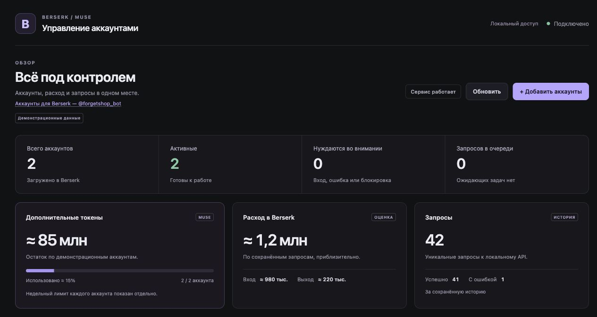

<h1 align="center">Berserk Muse</h1>
<p align="center"><b>Muse в привычных кодинг-агентах.</b><br>Локальный API, подключённые аккаунты и удобная панель управления.</p>
<p align="center">
  <a href="https://github.com/ForgetMeAI/berserk-muse/actions/workflows/test.yml"></a>
  <a href="https://nodejs.org/"></a>
  <a href="LICENSE"></a>
</p>



## Что умеет

- **Claude Code, Hermes и OpenCode** — работа с Muse через знакомые агенты.
- **Без постоянного окна Muse** — после входа используется сохранённая сессия.
- **Наглядная панель** — баланс, недельные лимиты, расход и история запросов.
- **Удобный импорт** — один аккаунт или целый список в формате `почта | ссылка на почту`.

> **Проверено 25 октября:** Claude Code 2.1.303 и Hermes 0.16.0 выполнили coding-задачу через живой Muse: исправили код, прошли три теста и сохранили подтверждение. Проверка — на macOS, одном тестовом аккаунте; у первых попыток были сбои. [Результаты и ограничения](docs/QUALIFICATION.md).

## Быстрый старт

Нужны **Node.js 22+** и **Chrome/Chromium** для входа. На Windows используйте [WSL2](docs/USER_GUIDE.md#linux-и-windows-через-wsl2).

```sh
git clone https://github.com/ForgetMeAI/berserk-muse.git
cd berserk-muse
npm ci --ignore-scripts
npm run launch
npm run panel
```

В панели нажмите **«Добавить аккаунты»**, вставьте `почта | ссылка на почту` и дождитесь статуса **«Активен»**. Если потребуется ручной вход, завершите его в открывшемся окне Muse.

Затем запустите установленный агент:

| Агент | Команда |
| --- | --- |
| Claude Code | `npm run client -- claude --work-dir ./workspace` |
| Hermes | `npm run client -- hermes --work-dir ./workspace` |
| OpenCode · macOS | `npm run agent -- "Опиши задачу"` |

Панель: **http://127.0.0.1:8787/panel** · Остановка: `npm run stop`

## Документация

| Нужно разобраться | Куда смотреть |
| --- | --- |
| Агенты, локальный API и настройки | [Руководство пользователя](docs/USER_GUIDE.md) |
| Почта и массовый импорт | [Аккаунты и панель](docs/USER_GUIDE.md#аккаунты-и-панель) |
| Платформы и установка браузера | [Linux / Windows через WSL2](docs/USER_GUIDE.md#linux-и-windows-через-wsl2) |
| Устройство проекта | [Архитектура](docs/ARCHITECTURE.md) |
| Что проверено и какие есть ограничения | [Статус проверок](docs/QUALIFICATION.md) |
| Обновление, ошибки Muse и браузерный режим | [Решение проблем](docs/TROUBLESHOOTING.md) |

Berserk — экспериментальный неофициальный клиент Muse. Автоматическое получение кодов поддерживается для Luuvan и Generator.email; при необходимости доступен ручной вход. Значения на скриншоте демонстрационные.

<p align="center"><a href="https://t.me/forgetmeai">@forgetmeai</a> · Аккаунты: <a href="https://t.me/forgetshop_bot">@forgetshop_bot</a> · <a href="LICENSE">MIT</a></p>
